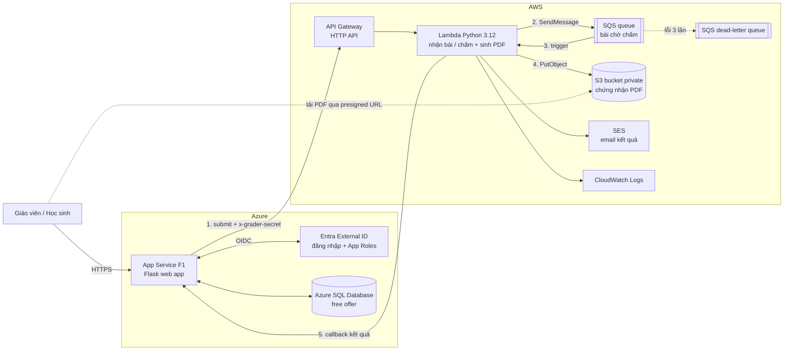

# QuizCloud: Hệ thống khảo sát & thi trắc nghiệm trực tuyến đa đám mây (Azure + AWS)

Giáo viên tạo đề → học sinh làm bài → bài nộp vào hàng đợi **Amazon SQS** → **AWS Lambda** tự chấm điểm, sinh **chứng nhận PDF** lưu trên **S3** và gửi link **presigned URL** cho học sinh.
Tài khoản & phân quyền Giáo viên/Học sinh dùng **Microsoft Entra External ID**, dữ liệu lưu ở **Azure SQL Database**.

> Chạy thử ngay trên máy, không cần tài khoản cloud: xem [Chạy demo trên máy](#chạy-demo-trên-máy-bấm-đúp-là-chạy).

## Kiến trúc



**Luồng nộp bài (bất đồng bộ):**

1. Web lưu bài làm vào Azure SQL (trạng thái *đang chấm*) rồi gửi `action: submit` sang API Gateway.
2. Lambda kiểm tra khóa bí mật, đẩy bài vào **SQS** và trả `202 queued` ngay. Học sinh thấy trang "Bài đang được chấm…", trang tự cập nhật.
3. SQS kích hoạt Lambda (cùng một hàm) để chấm điểm và sinh PDF bằng fpdf2.
4. Lambda lưu PDF lên S3.
5. Lambda gọi **callback** `POST /api/grader/callback` về web (kèm khóa bí mật), web ghi điểm vào Azure SQL. Sau đó Lambda gửi email kết quả qua SES.

Nếu callback lỗi, Lambda báo thất bại, SQS gửi lại tin nhắn; sau 3 lần thất bại, tin nhắn chuyển sang **dead-letter queue** để kiểm tra. Bài chờ quá 2 phút sẽ hiện nút **Chấm lại**.

Hàng đợi giúp hệ thống chịu được lúc cả lớp nộp cùng lúc khi hết giờ: web trả lời ngay, còn Lambda xử lý dần theo hàng đợi.
Lambda **không kết nối trực tiếp Azure SQL** (tránh cài ODBC driver trên Lambda và mở firewall SQL cho mọi IP). Mỗi lần mở trang kết quả, web xin presigned URL mới vì URL cũ đã hết hạn.

## Chức năng

| Vai trò | Chức năng |
|---|---|
| Giáo viên | Tạo/xoá bài thi (thời gian, ngưỡng đạt), thêm câu hỏi 1 hoặc nhiều đáp án, nhập câu hỏi từ CSV, mở/đóng bài thi, xem kết quả + thống kê (TB, max, min, tỉ lệ đạt), xuất **CSV**, **báo cáo HTML** in được (tỉ lệ đúng từng câu) |
| Học sinh | Xem bài thi đang mở, làm bài có đồng hồ đếm ngược (tự nộp khi hết giờ), 1 lần nộp, xem kết quả chi tiết từng câu, tải **chứng nhận PDF** (đạt) / **phiếu kết quả PDF** (chưa đạt), nhận email kết quả |
| Hệ thống | Phân quyền theo App Role của Entra, CSRF, chỉ chủ bài/giáo viên xem được bài nộp, chấm bất đồng bộ qua SQS, tự thử lại + dead-letter queue, chấm lại khi lỗi |

## Cấu trúc thư mục

```
.
├── README.md
├── run_demo.bat / run_demo.command / run_demo.sh   # chạy demo trên máy
├── reset_demo.bat                                  # xoá dữ liệu demo (Windows)
├── requirements-local.txt                          # thư viện cho bản demo
├── web/                    # Flask app → Azure App Service
│   ├── app.py              # route: giáo viên, học sinh, callback từ AWS
│   ├── auth.py             # đăng nhập Entra External ID (MSAL) / dev
│   ├── models.py           # bảng dữ liệu (Azure SQL / SQLite)
│   ├── grader_client.py    # gọi API Gateway (submit / grade / presign)
│   ├── config.py, demo_data.py, requirements.txt
│   ├── static/app.css
│   └── templates/
├── grader/                 # Code Lambda → AWS
│   ├── handler.py          # entry: API Gateway + SQS trigger
│   ├── service.py, grading.py, certificate.py
│   ├── fonts/              # font Unicode để PDF hiển thị tiếng Việt
│   ├── requirements.txt
│   └── build_zip.sh        # tạo grader.zip để upload lên Lambda
├── tests/                  # pytest
└── docs/bao-cao/           # bản nháp báo cáo (Markdown) + script xuất Word
```

## Chạy demo trên máy (bấm đúp là chạy)

Chỉ cần cài **Python 3.10 trở lên** (https://www.python.org/downloads/; trên Windows nhớ tick *Add python.exe to PATH*). Không cần tài khoản Azure/AWS.

| Hệ điều hành | Cách chạy |
|---|---|
| Windows | Bấm đúp `run_demo.bat` |
| macOS | Bấm đúp `run_demo.command` (lần đầu: chuột phải → Open) hoặc chạy `./run_demo.sh` |
| Linux | `./run_demo.sh` |

Lần đầu script tự tạo `.venv`, cài thư viện (khoảng 1 phút), sinh dữ liệu mẫu rồi mở trình duyệt tại http://127.0.0.1:5000.
Trang đăng nhập có nút **đăng nhập nhanh** cho Giáo viên và Học sinh. Dữ liệu mẫu gồm 3 bài thi và 9 bài nộp đã chấm.
Muốn làm lại từ đầu: chạy `reset_demo.bat` (Windows) hoặc `./run_demo.sh --reset`.

Ở chế độ demo, bài được chấm ngay trong app bằng chính code của Lambda (không qua AWS) và PDF lưu vào `web/instance/certificates/`.

## Chạy local cho dev (có test)

```bash
python3 -m venv .venv && . .venv/bin/activate      # Windows: .venv\Scripts\activate
pip install -r web/requirements.txt -r grader/requirements.txt pytest boto3
python -m pytest -q tests                          # chạy test

cd web
flask --app app init-db --demo                     # tạo bảng + dữ liệu mẫu (SQLite)
flask --app app run                                # http://localhost:5000
```

## Deploy

> Dùng **Azure for Students** (không cần thẻ) và tài khoản AWS mới. **Bật Budget Alert (~$1) trên cả 2 cloud** và **xoá tài nguyên sau khi chấm**. Hạn mức free tier có thể thay đổi, kiểm tra trang pricing trước khi tạo.
> Chọn cùng khu vực Singapore: AWS `ap-southeast-1`, Azure `Southeast Asia`.

### AWS (người A)

1. **S3**: tạo bucket (vd. `quizcloud-certs-<tên-nhóm>`), giữ nguyên *Block all public access*.
2. **SQS**: tạo 2 hàng đợi loại *Standard*:
   - `quizcloud-grading-dlq` (để mặc định).
   - `quizcloud-grading`: *Visibility timeout* = **180 giây**; mục *Dead-letter queue* → chọn `quizcloud-grading-dlq`, *Maximum receives* = **3**.
   Ghi lại **URL** và **ARN** của `quizcloud-grading`.
3. **IAM role cho Lambda**: gắn 2 policy có sẵn `AWSLambdaBasicExecutionRole` và `AWSLambdaSQSQueueExecutionRole`, thêm inline policy:
   ```json
   {"Version": "2012-10-17", "Statement": [
     {"Effect": "Allow", "Action": ["s3:PutObject", "s3:GetObject"], "Resource": "arn:aws:s3:::<BUCKET>/certificates/*"},
     {"Effect": "Allow", "Action": "sqs:SendMessage", "Resource": "<ARN của quizcloud-grading>"},
     {"Effect": "Allow", "Action": "ses:SendEmail", "Resource": "*"}]}
   ```
4. **Lambda**: runtime Python 3.12 (x86_64), chọn role trên, upload `grader.zip` (tạo bằng `grader/build_zip.sh`).
   Handler: `handler.lambda_handler`, Memory 512 MB, Timeout 30 s. Biến môi trường:

   | Tên | Giá trị |
   |---|---|
   | `CERT_BUCKET` | tên bucket |
   | `GRADER_SECRET` | chuỗi ngẫu nhiên dài (dùng chung với web) |
   | `GRADING_QUEUE_URL` | URL hàng đợi `quizcloud-grading` |
   | `WEB_CALLBACK_URL` | `https://<app>.azurewebsites.net/api/grader/callback` (lấy từ người làm App Service) |
   | `SES_SENDER` | (tuỳ chọn) email đã verify |
   | `PRESIGN_TTL_SECONDS` | (tuỳ chọn) mặc định `3600` |

5. **Trigger SQS**: trong Lambda → *Add trigger* → SQS → chọn `quizcloud-grading`, **Batch size = 1**.
6. **API Gateway** → *HTTP API* → integration là Lambda trên, route `POST /grade`. URL dạng `https://xxxx.execute-api.ap-southeast-1.amazonaws.com/grade` chính là `GRADER_URL`.
7. **SES** (tuỳ chọn): *Verified identities* → verify email gửi và các email nhận (SES sandbox chỉ gửi tới email đã verify, đủ cho demo).
8. Xem log tại **CloudWatch** → Log groups → `/aws/lambda/<tên-hàm>`; xem số tin nhắn chờ/lỗi trong trang SQS.

Test nhanh (thay URL và secret):
```bash
curl -X POST "$GRADER_URL" -H "x-grader-secret: $GRADER_SECRET" -H "Content-Type: application/json" \
  -d '{"action":"grade","submission_id":1,"student":{"name":"Test"},"exam":{"id":1,"title":"Test","pass_percent":50},"questions":[{"id":1,"points":1,"correct":[0]}],"answers":{"1":[0]}}'
```
Kết quả trả về có `score` và `certificate_url` là AWS đã chạy đúng.

### Azure (người B: Entra + SQL)

1. **Entra External ID**
   - Microsoft Entra admin center → tạo **external tenant**.
   - *App registrations* → New: Redirect URI (Web) `https://<app>.azurewebsites.net/auth/callback`. Tạo **client secret**.
   - *App roles* → tạo 2 role với **Value** `Teacher` và `Student` (Allowed member types: Users).
   - *User flows* → tạo flow đăng ký/đăng nhập (email + mật khẩu), thêm application vào flow.
   - *Enterprise applications* → app → *Users and groups* → gán user vào role Teacher/Student. User chưa có role sẽ thấy trang "chưa được phân quyền".
   - Authority: `https://<tenant-subdomain>.ciamlogin.com/<tenant-subdomain>.onmicrosoft.com`
2. **Azure SQL Database**: khi tạo, chọn **Apply offer** (free serverless database). Ở *Networking* bật *Allow Azure services* và thêm IP máy mình để chạy lệnh tạo bảng.
   Tạo bảng từ máy local (ở thư mục gốc repo, đã cài thư viện như phần dev):
   ```bash
   cd web
   DATABASE_URL='mssql+pymssql://<user>:<password>@<server>.database.windows.net:1433/<db>' flask --app app init-db
   ```
   (Mật khẩu có ký tự đặc biệt thì URL-encode. Database free tự pause khi rảnh, lần kết nối đầu có thể chậm/lỗi, thử lại sau vài giây.)

### Azure App Service (người C)

Linux, Python 3.12, gói **F1 Free**, deploy thư mục `web/`:
```bash
cd web
az webapp up --name <app> --runtime PYTHON:3.12 --sku F1 --location southeastasia
az webapp config set --name <app> --resource-group <rg> --startup-file "gunicorn --bind=0.0.0.0 --timeout 120 app:app"
```
*Settings → Environment variables*:

| Tên | Giá trị |
|---|---|
| `SECRET_KEY` | chuỗi ngẫu nhiên |
| `DATABASE_URL` | từ người B |
| `AUTH_MODE` | `entra` (để `dev` khi mới deploy thử) |
| `ENTRA_CLIENT_ID`, `ENTRA_CLIENT_SECRET`, `ENTRA_AUTHORITY` | từ người B |
| `GRADER_URL`, `GRADER_SECRET` | từ người A |
| `GRADER_ASYNC` | `true` (chấm qua SQS + callback); bỏ trống = gọi Lambda chấm đồng bộ |
| `SCM_DO_BUILD_DURING_DEPLOYMENT` | `true` |

Thứ tự ghép nối nên làm: deploy với `AUTH_MODE=dev` → thêm `DATABASE_URL` → thêm `GRADER_URL`/`GRADER_SECRET` (đồng bộ) → bật `GRADER_ASYNC=true` → chuyển `AUTH_MODE=entra`. Sau mỗi bước, thử lại luồng tạo đề → làm bài → tải PDF.

## Grader API (hợp đồng giữa Azure và AWS)

Tất cả request `POST GRADER_URL` đều có header `x-grader-secret`.

| `action` | Body thêm | Trả về |
|---|---|---|
| `submit` | bài nộp (như dưới) | `202 {"status": "queued", "message_id": "..."}`, kết quả gửi sau qua callback |
| `grade` | bài nộp | `200` kết quả + `certificate_url` (chấm đồng bộ) |
| `presign` | `certificate_key` | `{"certificate_url": "..."}` |

Bài nộp:
```json
{"submission_id": 7,
 "student": {"name": "Nguyễn An", "email": "an@school.edu"},
 "exam": {"id": 3, "title": "Kiểm tra Cloud", "pass_percent": 50},
 "questions": [{"id": 1, "points": 1, "correct": [1]}, {"id": 2, "points": 2, "correct": [0, 2]}],
 "answers": {"1": [1], "2": [0, 2]}}
```

Callback Lambda → web: `POST WEB_CALLBACK_URL` (header `x-grader-secret`):
```json
{"submission_id": 7, "score": 3, "max_score": 3, "percent": 100, "passed": true, "details": [...],
 "certificate_id": "74037BA453", "certificate_key": "certificates/exam-3/submission-7-74037BA453.pdf"}
```

Quy tắc chấm: câu nhiều đáp án chỉ được điểm khi chọn **đúng và đủ**.

## Danh sách dịch vụ (dùng cho báo cáo)

- **Azure:** Microsoft Entra External ID, App Service, Azure SQL Database.
- **AWS:** API Gateway, Lambda, SQS (+ dead-letter queue), S3 (presigned URL), SES, CloudWatch, IAM.
